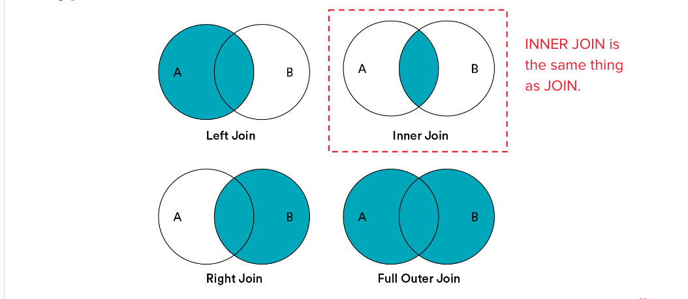

<h1>
  <span class="headline">Cleaning and Combining Data With Pandas</span>
  <span class="subhead">Combining Data</span>
</h1>

**Learning objective:** By the end of this lesson, students will be able to effectively use `groupby()` for aggregation, concatenate DataFrames, perform JOIN operations to combine datasets, and apply various types of JOINs to manage and analyze data.

| Lesson         | Duration |
| -------------- | -------- |
| Combining Data | 45 min   |

## Aggregating With `groupby()`

In Pandas, `groupby()` statements allow us to segment our population into specific subsets and draw calculations based on those segments.

```python
data_frame.groupby(['column_a']).count()
```

We can think about a `groupby()` statement in three steps:

1. **Split:** Separate our DataFrame into groups according to a specific attribute.
2. **Apply:** Apply some function to the groups, like sum, count, or max.
3. **Combine:** Put our DataFrame back together.

Aggregate findings are vital to generating insights and formulating hypotheses from data, which are often more difficult than simply executing chosen operations on a data set.

## Taking Aggregate Measures

We can use the `.agg()` method to get multiple aggregate values:

```python
df.groupby('col_a')['col_b'].agg(['count', 'mean', 'min', 'max'])
```

This command:

- Takes our DataFrame, `df`

- Groups it by the values in `.groupby('col_a')`

- And calculates the count, mean, minimum, and maximum of `['col_b']`.

We can also `groupby()` multiple columns to drill down further:

```python
df.groupby(['first_column', 'second_column'])
```

<br>

<div class="activity solo-exercise">
  <h2 class="title">3.3 <code>groupby()</code> Insights</h2>
  <span class="minutes">15 min</span>
</div>

Use `groupby()` to segment the data from Superstore in **Section 3.3**.


## Concatenate

We can combine two DataFrames together with `df.concat()`, which gives us the option to stack the DataFrames or add them as new columns.

```python
df1 = pd.DataFrame([['a', 1], ['b', 2]], columns=['letter', 'number'])
df2 = pd.DataFrame([['c', 3], ['d', 4]], columns=['letter', 'number'])

df_with_more_rows = pd.concat([df1, df2])
df_with_more_columns = pd.concat([df1, df2], axis=1)
```

> 💡 In this example, we are working with Pandas DataFrames created directly from lists, which is a slightly different approach compared to reading data from a `.csv` file. The columns parameter specifies the column names, so both DataFrames have columns labeled 'letter' and 'number'.

## What Is JOINing?

**JOINing** is the process of **_combining DataFrames according to specific values_**.

Traditionally, this would be done with **SQL**.

JOINing allows us to:

- **Reduce the size** of a database.

- **Increase the speed** at which data is queried and returned.

- **Reduce the redundancy** of the data stored in the database.

JOINing is fundamental to proper data architecture, and we'll get to do it in Pandas.

> 💡 SQL is used for querying and managing databases, similar to how Python handles data manipulation with libraries like Pandas. While SQL is primarily focused on retrieving and managing structured data within databases, Python offers more flexibility for performing complex data manipulations and transformations across various data formats.

## JOINs

A **JOIN** relies on multiple data sets that share a common unique identifier, or "key."

| **id** | **name** | **vehicle_id** |
| ------ | -------- | -------------- |
| 1      | Janet    | 3              |
| 2      | Terrell  | 4              |
| 3      | Yoko     | 4              |
| 4      | Lee      | 1              |

| **id** | **vehicle_name** |
| ------ | ---------------- |
| 1      | Explorer         |
| 2      | Civic            |
| 3      | Corolla          |
| 4      | Impala           |

A JOIN is used to combine tables for the purpose of adding selection criteria and possibly additional columns:

| id  | name    | vehicle_id | vehicle_name |
| --- | ------- | ---------- | ------------ |
| 1   | Janet   | 3          | Corolla      |
| 2   | Terrell | 4          | Impala       |
| 3   | Yoko    | 4          | Impala       |
| 4   | Lee     | 1          | Explorer     |

<br>

- They connect data sources together in order to use information from both tables to display a desired result.

- A JOIN allows for tables to be connected using common columns, which serve as unique identifiers (called KEYS).

- Note that unique identifiers aren’t required, but are almost always used to avoid unintended behavior.

- In this example, "drivers.id" is the primary key (PK) and "drivers.vehicle_id" is the foreign key (FK) of the "drivers" table.

- Conversely, "vehicle.id" is the PK of the "vehicles" table, and there is no FK.

- The "drivers" table is the fact table, and the "vehicles" table is the dimension table.

## Types of JOINs

There are four types of JOINs; each has its own use case. You’ll decide which JOINS you want to use based on the tables with which you’re working.

- **INNER JOIN** is the default.
- If we don’t want to perform an **INNER JOIN**, we specify this in the syntax of our query ("**LEFT JOIN**" for example).
- In this lesson, we’ll focus on **INNER** and **LEFT JOIN**s.

<br>



For now, keep in mind that:

- **FULL OUTER JOIN** is also known as **OUTER JOIN**.
- **LEFT JOIN** is also known as LEFT **OUTER JOIN**.
- **RIGHT JOIN** is also known as RIGHT **OUTER JOIN**.

## Using `merge`

The robust method for JOINing in Pandas is `merge()`, which accepts several parameters:

```python
pd.merge(left_df, right_df, how, left_on, right_on)
```

As you may have guessed, the first two parameters are the DataFrames to JOIN. The third parameter describes the type of JOIN, typically "left." The last two parameters provide the column name for the shared column, or foreign key, that will be used to combine the two DataFrames.

> We provide an example of this in the first exercise in the workbook, so you will have a more concrete example to start working from.

<br>

<div class="activity group-exercise">
  <h2 class="title">3.4 JOINing Data Sets</h2>
  <span class="minutes">15 min</span>
</div>

Let’s practice JOINing stock data and the Superstore data in **Section 3.4** of the workbook.


