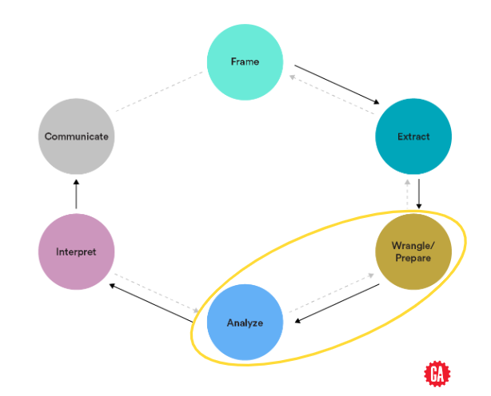

<h1>
  Cleaning and Combining Data With Pandas
  Intro to Cleaning and Combining Data
</h1>

**Learning objective:** By the end of this lesson, students will be able to identify where data cleaning and combining happens in a data analytics workflow. 

| Lesson                               | Duration |
| ------------------------------------ | -------- |
| Intro to Cleaning and Combining Data | 5 min    |

# Cleaning and Combining Data With Pandas

## Our Learning Goals

- Use Pandas to handle missing or problematic data values.

- Identify appropriate cleaning strategies for specific data types.

- Use `groupby()` and JOIN statements to combine data with Pandas.

- Create insights from data by splitting and combining data segments.

> 🍎 This lesson is simply an introduction to the topic. The suggested methods for handling missing data are by no means comprehensive solutions nor should they be considered a go-to approach for missing data. This is a big topic worthy of further study after the course has ended.

## The Data Analytics Workflow

- **Wrangle/Prepare:** Clean and prepare relevant data.
- **Analyze:** Structure, comprehend, and visualize data.

